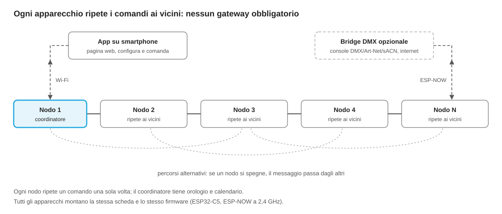

# DinamicMesh_wireless – Linea RGB architetturale wireless

Progetto Versus Lux di una nuova linea di apparecchi RGB per facciate, ponti e grandi strutture, comandati via radio invece che con il cavo DMX. Agli apparecchi arriva solo l'alimentazione; i dati viaggiano su una rete mesh tra gli apparecchi stessi.



## Scelte principali

| Tema | Scelta |
| --- | --- |
| Canali | 5 PWM per apparecchio: RGB+W+Ambra oppure RGB+bianco caldo+bianco freddo |
| Fase 1 | Scene, colori e sequenze programmate; il pixel mapping va su una variante cablata (fase 2) |
| Rete | Mesh ESP-NOW a 2,4 GHz: ogni apparecchio ripete i comandi ai vicini, nessun gateway obbligatorio |
| Sincronia | Comandi temporizzati ("esegui scena N all'istante T") e orologio comune |
| Hardware | Una sola scheda nodo per tutta la linea, con modulo ESP32-C5 certificato |
| App | Pagina web via Wi-Fi, servita dal coordinatore o dal bridge; nessun Bluetooth |
| Compatibilità DMX | Bridge opzionale con ingressi DMX512, Art-Net e sACN |
| Internet | Configurazione connessa con router dedicato all'impianto, separato dalla rete dello stabile |
| Licenze | Nessuna: niente CRMX, niente qualifica Bluetooth SIG, niente Matter |
| Certificazioni | Modulo radio già certificato, solo 2,4 GHz, autocertificazione CE secondo la direttiva RED |
| Antenna | Tappo plastico per le barre lineari; nodo esterno resinato o antenna passante per i proiettori |

## Contenuto del repository

| Percorso | Contenuto |
| --- | --- |
| [`docs/registro-decisioni.md`](docs/registro-decisioni.md) | Registro delle decisioni prese, sintesi delle analisi, punti aperti e prossimi passi |
| [`docs/specifica-tecnica.md`](docs/specifica-tecnica.md) | Specifica tecnica completa: requisiti, architettura, hardware, antenne, protocollo, latenza, dimensionamento, software, certificazioni, piano di prove, scelte aperte |
| [`docs/schema-rete-mesh.svg`](docs/schema-rete-mesh.svg) | Schema della rete |
| [`calcoli/dimensionamento_rete.py`](calcoli/dimensionamento_rete.py) | Script di calcolo di latenza e occupazione del canale (facciata 10×10 m) |
| [`docs/simulazioni-coesistenza.md`](docs/simulazioni-coesistenza.md) | Risultati delle simulazioni di coesistenza a 2,4 GHz (facciata e ponte) |
| [`simulazioni/`](simulazioni/) | Simulatore Monte Carlo di interferenze, mesh e ripetizioni, con grafici e dati |
| [DinamicMesh_tester](https://github.com/lucaversus/DinamicMesh_tester) | Repository dello strumento di test della rete mesh (apparecchio a batteria con schermo, due ESP32-C5, GPS, scanner di spettro) |
| [`reports/Analisi concorrenza illuminazione dinamica.md`](<reports/Analisi concorrenza illuminazione dinamica.md>) | Ricerca di mercato: concorrenti wireless e cablati, progetti realizzati, tecniche costruttive, prezzi, implicazioni per Versus Lux |
| [`research_notes/Analisi concorrenza illuminazione dinamica/`](<research_notes/Analisi concorrenza illuminazione dinamica/>) | Note di ricerca dettagliate con tutte le fonti, per filone |
| [`reports/Lumentalk dati su linea elettrica.md`](<reports/Lumentalk dati su linea elettrica.md>) | Approfondimento su Lumentalk (Lumenpulse) e sulle altre tecnologie dati su cavo di alimentazione, confronto con la mesh |
| [`research_notes/Lumentalk dati su linea elettrica/`](<research_notes/Lumentalk dati su linea elettrica/>) | Note e fonti primarie dell'approfondimento Lumentalk |

Per rifare i calcoli con ipotesi diverse, modifica le costanti in testa allo script ed eseguilo:

```bash
python3 calcoli/dimensionamento_rete.py
```

## Fonte unica

Questo repository è l'unica fonte aggiornata della specifica: le modifiche si fanno qui, in `docs/specifica-tecnica.md`. Il documento di lavoro iniziale su Claude è archiviato e non viene più aggiornato.

## Progetti collegati

- [DinamicMesh_tester](https://github.com/lucaversus/DinamicMesh_tester): strumento di test della rete mesh.

[Spotlight_Motion](https://github.com/lucaversus/Spotlight_Motion): spot motorizzati per interni (pan 360°, tilt 180°). La scheda motori è un nodo della stessa rete mesh, con lo stesso firmware di base e la stessa app.

## Prossimi passi

1. Banco di prova con 5 nodi su ESP32-C5-DevKitC-1: inoltro mesh, scene, sincronismo, app via Wi-Fi.
2. Prova a catena lunga e prova di portata su una struttura metallica reale.
3. Confronto delle soluzioni d'antenna sullo stesso corpo.
