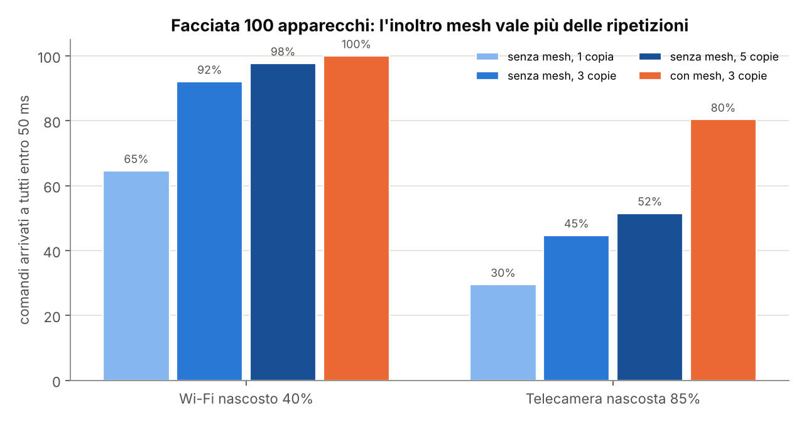
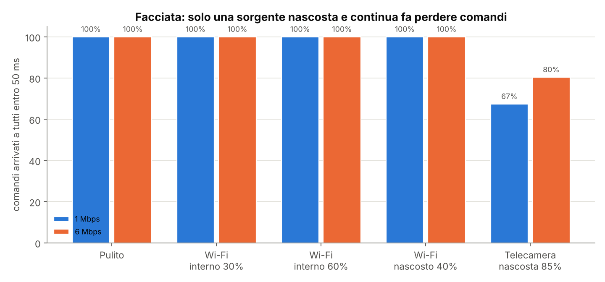
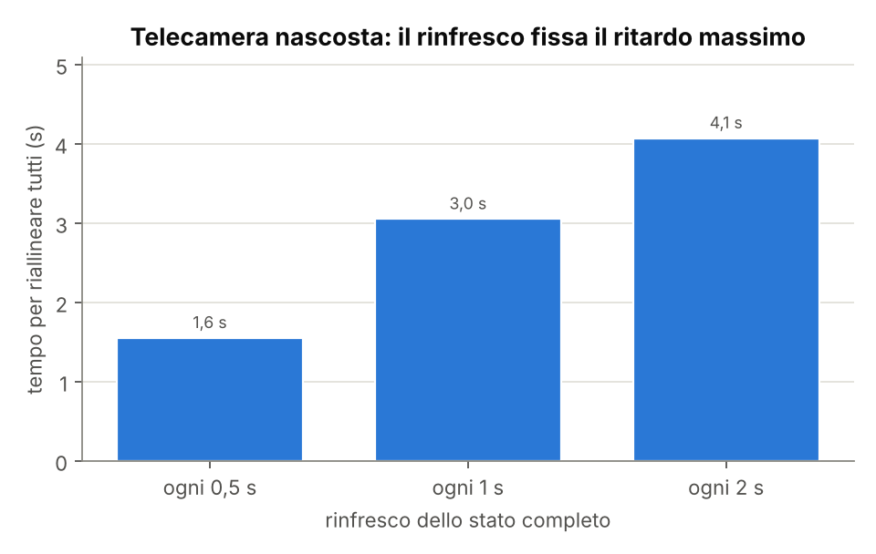
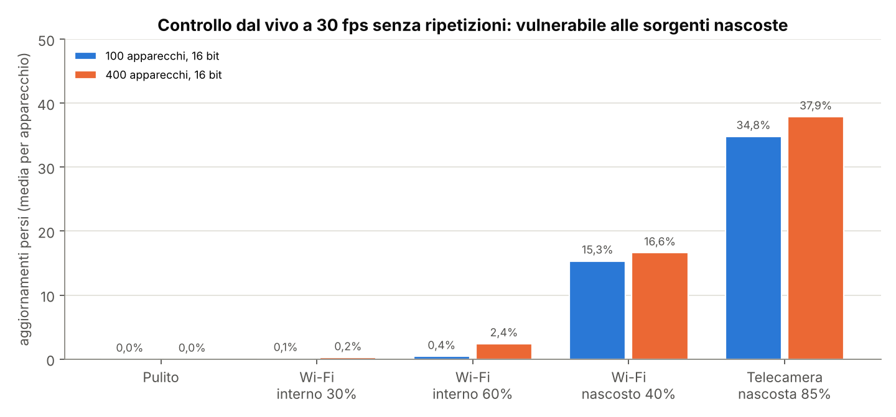
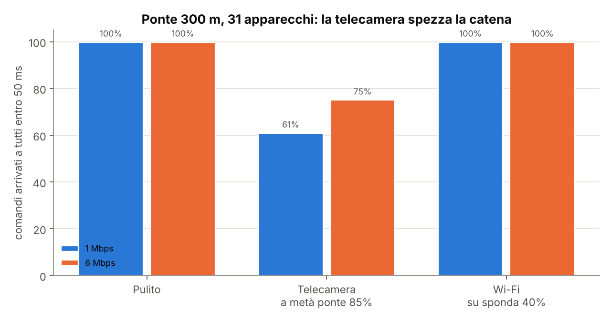

# Simulazioni di coesistenza a 2,4 GHz

8 novembre 2026 · simulatore: [`simulazioni/coesistenza_24ghz.py`](../simulazioni/coesistenza_24ghz.py) · dati: [`simulazioni/risultati/risultati.json`](../simulazioni/risultati/risultati.json)

**In sintesi.** Il Wi-Fi che gli apparecchi "sentono", anche se occupa il 60% del canale, non fa perdere comandi: aggiunge solo qualche millisecondo di ritardo. Il pericolo vero è la sorgente **nascosta e continua**, per esempio una telecamera Wi-Fi che gli apparecchi vicini al coordinatore non sentono: lì il 20-25% dei comandi non arriva a tutti entro 50 ms, e il ritardo massimo dipende dal rinfresco dello stato. Tre indicazioni per il progetto: l'inoltro mesh tra apparecchi è la difesa principale, conta più delle copie inviate dal coordinatore; 6 Mbps è meglio di 1 Mbps sotto interferenza a raffiche; il controllo dal vivo va protetto a parte, perché senza ripetizioni perde fino al 38% degli aggiornamenti con una sorgente nascosta.

I numeri sono **comparativi**, non assoluti: servono a scegliere la strada e a decidere cosa misurare al banco. Le ipotesi sono elencate in fondo.

## Cosa è stato simulato

| Elemento | Modello |
| --- | --- |
| Propagazione | Perdita log-distanza (esponente 2,5 in facciata, 2,7 sul ponte), 5 dB di perdita per estremo dovuta al corpo dell'apparecchio, shadowing di 4 dB per collegamento, fading di 2 dB per pacchetto |
| Radio dei nodi | 15 dBm; sensibilità -97 dBm a 1 Mbps e -92 dBm a 6 Mbps; rapporto segnale/interferenza minimo 3 dB e 6 dB |
| Accesso al canale | Ascolto prima di trasmettere: un nodo rimanda se sente un preambolo Wi-Fi sopra -82 dBm o un altro nodo; gli interferenti a loro volta rimandano se sentono il nodo |
| Interferenti | Wi-Fi a raffiche (ON e OFF esponenziali, raffiche medie di 3 ms) e telecamera continua (raffiche medie di 30 ms, 85% del tempo), 20 dBm |
| Protocollo | Comando di scena di 48 byte, esecuzione 50 ms dopo l'invio; 1, 3 o 5 copie del coordinatore in 30 ms; inoltro mesh una volta per nodo, annullato se il nodo ha già sentito 3 copie; rinfresco dello stato completo ogni 0,5, 1 o 2 s |
| Controllo dal vivo | 30 aggiornamenti al secondo dal coordinatore, pacchetti da 250 byte, nessuna ripetizione né inoltro; un aggiornamento non arrivato entro il successivo è perso |
| Ripetizioni | 1.000 simulazioni per ogni caso di scena; 100 per ogni caso di controllo dal vivo |

**Geometrie e scenari.**

- **Facciata 10×10 m, 100 apparecchi**, coordinatore in un angolo (caso peggiore).
  - Pulito: nessun interferente.
  - Wi-Fi interno 30% e 60%: access point 3 m dietro una vetrata, al centro della facciata. Tutti gli apparecchi lo sentono.
  - Wi-Fi nascosto 40%: access point di un vicino oltre l'angolo dell'edificio. Gli apparecchi della metà vicina al coordinatore non lo sentono (30 dB di schermatura), quelli dell'altra metà sì.
  - Telecamera nascosta 85%: stessa posizione, trasmissione video quasi continua.
- **Ponte 300 m, 31 apparecchi ogni 10 m**, coordinatore a un'estremità.
  - Telecamera su una sponda a metà ponte.
  - Wi-Fi di un locale su una sponda.

## Risultati

### 1. La mesh vale più delle ripetizioni



Con il Wi-Fi nascosto al 40%, senza inoltro mesh i comandi arrivano a tutti in tempo nel 65% dei casi con una copia sola e nel 98% con cinque. Con la mesh si arriva al 100% già con tre copie. Con la telecamera nascosta la differenza è ancora più netta: 30-52% senza mesh, 80% con la mesh. Il motivo: gli apparecchi nella zona disturbata sentono la telecamera, aspettano un istante libero e inoltrano il comando ai vicini proprio in quell'istante, mentre il coordinatore, che non la sente, trasmette alla cieca.

**Indicazione:** l'inoltro mesh è indispensabile anche su una facciata piccola dove tutti sentono il coordinatore. Tre copie del coordinatore bastano; cinque non aggiungono quasi nulla quando c'è la mesh.

### 2. Il Wi-Fi udibile ritarda ma non fa perdere comandi



| Scenario (mesh, 3 copie) | Comandi a tutti in tempo, 1 Mbps | idem, 6 Mbps | Apparecchi in tempo, 6 Mbps | Ritardo dell'ultimo apparecchio (95%), 6 Mbps |
| --- | --- | --- | --- | --- |
| Pulito | 100% | 100% | 100% | 0,6 ms |
| Wi-Fi interno 30% | 100% | 100% | 100% | 6,3 ms |
| Wi-Fi interno 60% | 100% | 100% | 100% | 8,2 ms |
| Wi-Fi nascosto 40% | 100% | 100% | 100% | 9,2 ms |
| Telecamera nascosta 85% | 67% | 80% | 93% | 100 ms |

Con il Wi-Fi udibile, anche al 60%, l'ascolto prima della trasmissione fa il suo lavoro: i ritardi restano sotto i 10 ms, ben dentro la finestra di 50 ms. Solo la sorgente nascosta e quasi continua fa perdere comandi.

**6 Mbps contro 1 Mbps:** con interferenze a raffiche vince 6 Mbps (80% contro 67%), perché i pacchetti sono più corti e entrano negli intervalli liberi tra una raffica e l'altra. 1 Mbps resta utile solo dove serve più portata.

### 3. Il rinfresco dello stato fissa il ritardo massimo



Nello scenario peggiore (telecamera nascosta) gli apparecchi che perdono un comando si riallineano grazie al rinfresco. Con rinfresco ogni 0,5 o 1 s è successo in tutte le 1.000 prove; con rinfresco ogni 2 s, in 2 prove su 1.000 qualche apparecchio non era ancora allineato alla fine della simulazione (8 s). Il 99% delle volte tutti sono allineati entro 1,6 s con rinfresco ogni 0,5 s, entro 3 s con rinfresco ogni secondo ed entro 4 s ogni 2 secondi. Il caso peggiore osservato su 1.000 prove è di 5-6 s con rinfresco ogni secondo.

**Indicazione:** rinfresco ogni 0,5-1 s. Il traffico che aggiunge è trascurabile: un pacchetto ogni mezzo secondo. Ma soprattutto, uno scenario come questo deve far scattare il **cambio di canale**: con un canale pulito si torna al 100%. La diagnostica deve quindi riconoscerlo, perché un apparecchio che si riallinea dopo 3 secondi è accettabile una volta, non a ogni cambio di scena.

### 4. Il controllo dal vivo va protetto a parte



| Scenario, 16 bit | 100 apparecchi: aggiornamenti persi | 400 apparecchi: aggiornamenti persi | Blocco più lungo (400 apparecchi) |
| --- | --- | --- | --- |
| Pulito | 0% | 0% | 0 |
| Wi-Fi interno 30% | 0,1% | 0,2% | 67 ms |
| Wi-Fi interno 60% | 0,4% | 2,4% | 100 ms |
| Wi-Fi nascosto 40% | 15% | 17% | 0,47 s |
| Telecamera nascosta 85% | 35% | 38% | 2 s |

Il traffico proprio occupa il 5% del canale con 100 apparecchi e il 21% con 400 apparecchi a 16 bit. Con il Wi-Fi udibile il controllo dal vivo regge. Con una sorgente nascosta, invece, il flusso diretto dal coordinatore, senza ripetizioni né mesh, perde molti aggiornamenti e si vedono blocchi fino a 2 secondi.

**Indicazione:** il controllo dal vivo non può usare solo il flusso diretto. Le opzioni sono tre, da confrontare al banco: inoltro mesh anche dei dati dal vivo (raddoppia il traffico), una copia di ogni aggiornamento mandata da un apparecchio nella zona disturbata, oppure abilitare il controllo dal vivo solo dopo una misura del canale che escluda sorgenti nascoste. Per le scene e i calendari, che sono il cuore della fase 1, il problema non si pone.

### 5. Sul ponte la telecamera spezza la catena



| Scenario (mesh, 3 copie) | Comandi a tutti in tempo, 1 Mbps | idem, 6 Mbps | Apparecchi in tempo, 6 Mbps | Salti massimi | Riallineamento (99%) |
| --- | --- | --- | --- | --- | --- |
| Pulito | 99,8% | 99,8% | 100% | 4-5 | 0,05 s |
| Telecamera a metà ponte 85% | 61% | 75% | 83% | 7-8 | 3 s |
| Wi-Fi su sponda 40% | 99,8% | 99,8% | 99,9% | 5-6 | 0,05 s |

Anche senza interferenze, ogni tanto un apparecchio all'estremità perde un comando per un collegamento al limite della portata: il rinfresco lo recupera entro un secondo. Una telecamera a metà ponte, invece, interrompe la catena di inoltro e un comando su quattro non arriva in tempo agli apparecchi oltre la telecamera.

**Indicazione:** sui ponti conviene lasciare margine sulla distanza tra apparecchi, fare sempre la misura del canale in installazione e valutare due coordinatori, uno per estremità. Quest'ultima idea non è ancora simulata.

## Cosa cambia nella specifica

| Parametro | Valore iniziale suggerito | Da confermare al banco |
| --- | --- | --- |
| Inoltro mesh | Sempre attivo, una ritrasmissione per nodo, annullata dopo 3 copie sentite | Sì |
| Copie del coordinatore | 3 | Sì |
| Velocità radio | 6 Mbps; 1 Mbps o Long Range solo per collegamenti lunghi | Sì |
| Rinfresco dello stato | ogni 0,5-1 s | Sì |
| Cambio di canale | Automatico quando la diagnostica rileva comandi persi o ritardi oltre una soglia | Soglia da fissare |
| Controllo dal vivo | Protezione dedicata (inoltro o copia locale) oppure abilitato solo su canale verificato | Scelta da fare con le prove |

## Ipotesi e limiti

- Le prestazioni radio (sensibilità, soglie segnale/interferenza, perdita del corpo dell'apparecchio) sono valori tipici, non misurati sull'ESP32-C5. Al banco vanno misurate e inserite nel simulatore.
- Le posizioni degli interferenti e la schermatura di 30 dB "dietro l'angolo" sono ipotesi costruite per riprodurre il nodo nascosto: indicano cosa succede in quel caso, non quanto spesso capita.
- Non sono modellati: adattamento automatico della velocità, ritrasmissioni a livello MAC, tempi di gestione dei pacchetti nel chip, cambio di canale (che equivale a passare allo scenario pulito), salto di frequenza, modalità Long Range.
- Il controllo dal vivo è simulato su salto singolo, senza inoltro.
- Il percentile 99 del riallineamento varia di circa un secondo tra serie diverse di simulazioni: va letto come ordine di grandezza.

## Come rifare le simulazioni

```bash
cd simulazioni
python3 coesistenza_24ghz.py --runs 1000 --out risultati   # circa 6-7 minuti
python3 grafici.py
```

Scenari, geometrie e parametri radio sono definiti in testa al file e nelle funzioni `facade_scenarios()` e `bridge_scenarios()`.
