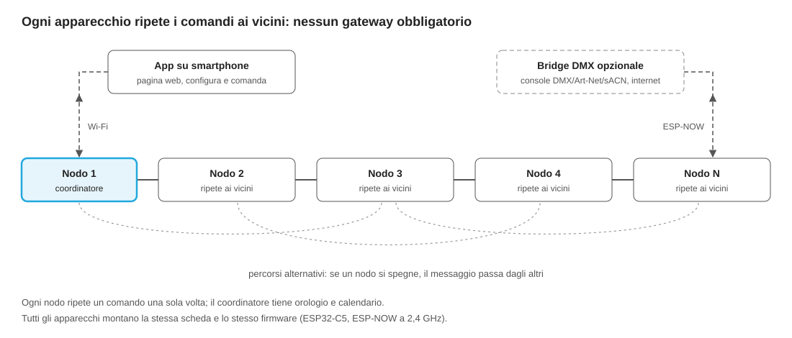

# Specifica tecnica – Linea RGB architetturale wireless

8 novembre 2026 · Luca – Versus Lux

Fonte unica della specifica: le modifiche si fanno in questo file. La storia delle revisioni è quella dei commit del repository.

## Obiettivo e ambito

La nuova linea illumina facciate, ponti e grandi strutture senza cavo dati DMX tra gli apparecchi: i dati viaggiano via radio, l'alimentazione resta cablata.

- **Mercato**: architetturale e infrastrutturale, non residenziale. L'interoperabilità con domotica (Matter, Alexa, Google) non è richiesta.
- **Fase 1**: scene, colori statici e sequenze programmate, con apparecchi a 5 canali.
- **Fase 2**: variante per contenuti video pixel per pixel, con ingresso dati cablato, sulla stessa piattaforma firmware e software.
- **Vincolo**: ogni impianto deve restare comandabile dalle console e dai software DMX/Art-Net/sACN già in commercio, tramite un bridge opzionale.
- **Elemento distintivo**: gli apparecchi parlano tra loro in rete mesh, senza gateway obbligatorio. Si installano portando solo l'alimentazione e si configurano dallo smartphone.
- **Vincolo aziendale**: nessuna licenza o quota di terzi (CRMX, Bluetooth SIG, Matter) e costi di certificazione contenuti, adatti a una piccola azienda.

## Requisiti funzionali

Ogni apparecchio gestisce 5 canali PWM indipendenti, con la stessa elettronica per due configurazioni di sorgente LED.

| Requisito | Specifica proposta | Note |
| --- | --- | --- |
| Canali | 5 PWM, configurazione RGB+W+Ambra oppure RGB+bianco caldo+bianco freddo | Profilo scelto in fabbrica o da app |
| Risoluzione dimming | 16 bit per canale, curva di dimming selezionabile | Evita gradini a bassa luminosità |
| Frequenza PWM | Da definire, sopra la soglia di flicker visibile e per le riprese video | Scelta aperta |
| Scene in memoria | Da definire (indicativamente decine) | Salvate in flash sul nodo |
| Sequenze | Transizioni, cicli di colore, effetti a tempo eseguiti in locale | Parametri inviati via rete |
| Calendario | Accensioni e scene per data e ora, anche astronomiche (alba/tramonto) | Eseguito dal nodo coordinatore |
| Sincronizzazione | Tutti gli apparecchi di una zona cambiano scena nello stesso istante | Precisione da definire |
| Compatibilità | Ingresso DMX512, Art-Net e sACN sul bridge opzionale, con mappatura canali | Console e software esistenti |
| Funzionamento autonomo | In assenza di rete il nodo mantiene l'ultima scena o la scena di sicurezza | Configurabile |
| Configurazione | Indirizzamento, raggruppamento, diagnostica e aggiornamenti da app | Ecosistema proprietario |

## Architettura di sistema

Gli apparecchi formano una rete mesh: ognuno riceve i comandi e li ripete ai vicini, così il messaggio arriva fino all'ultimo punto della facciata o del ponte senza gateway. Tutti montano lo stesso firmware; uno fa da coordinatore e tiene orologio e calendario.

Si configura e si comanda dallo smartphone via Wi-Fi: nessun Bluetooth nel sistema. Il bridge DMX è un accessorio opzionale: serve a chi vuole comandare l'impianto da una console esistente o collegarlo a internet.

- **Coordinatore**: nominato in automatico o dall'app. Se si guasta, il ruolo passa a un altro apparecchio.
- **Impianti molto grandi**: oltre un numero di salti da misurare sul campo, l'impianto si divide in più reti collegate tra loro.

### Collegamento dell'app e accesso a internet

Due configurazioni con lo stesso firmware: base, senza altro hardware, e connessa, con un access point dedicato all'impianto.

| Configurazione | Come si collega il telefono | Internet | Quando usarla |
| --- | --- | --- | --- |
| Base | Il coordinatore apre una propria rete Wi-Fi; l'app è una pagina web servita dall'apparecchio | No per l'impianto; il telefono può restare sui dati mobili | Impianti piccoli, messa in servizio |
| Connessa | Router o access point dedicato all'impianto, con uscita internet dalla rete dello stabile o da SIM 4G; bridge collegato al router via Ethernet | Sì: telefono, assistenza remota, ora da internet, aggiornamenti firmware | Impianti grandi, ponti, clienti che vogliono il controllo a distanza |

- **Gli apparecchi restano sulla mesh**: non si collegano all'access point. Un access point commerciale regge poche decine di client e quelli lontani non lo raggiungerebbero.
- **Sulla rete Wi-Fi dell'impianto** ci sono solo il bridge, i telefoni e gli eventuali altri dispositivi che devono interagire.
- **Canali separati**: con il bridge in Ethernet, la mesh ESP-NOW può stare su un canale radio diverso da quello del Wi-Fi e non ne subisce il traffico.
- **Separazione dallo stabile**: il router prende dalla rete dello stabile solo l'accesso a internet; l'IT dello stabile vede un unico dispositivo.
- **Nessuna certificazione in più**: il router è un prodotto commerciale già marcato CE.

## Hardware: nodo e bridge opzionale

Proposta di partenza: una sola scheda nodo per tutta la linea, con modulo radio Espressif già certificato e connettore per antenna esterna. L'ESP32-C5 è in produzione di serie da aprile 2025 ([Espressif](https://www.espressif.com/en/news/ESP32-C5_Mass_Production)); per la rete si usa la banda dei 2,4 GHz.

| Blocco | Nodo (ogni apparecchio) | Bridge DMX (accessorio opzionale) |
| --- | --- | --- |
| Processore e radio | Modulo ESP32-C5 certificato, versione con connettore per antenna esterna, CPU RISC-V 240 MHz ([Electronics Lab](https://www.electronics-lab.com/esp32-c5-soc-offers-dual-band-wi-fi-6-ble-zigbee-and-thread-along-with-esp32-c5-devkitc-1-development-board/)) | Stesso modulo del nodo |
| Rete | ESP-NOW a 2,4 GHz tra apparecchi; Wi-Fi verso l'app sul nodo coordinatore | ESP-NOW verso la rete mesh |
| Ingressi cablati | Nessuno (fase 1); Ethernet o DMX nella variante pixel | DMX512 su RS-485 isolato, Ethernet per Art-Net/sACN |
| Antenna | Esterna o passante stagno: un corpo metallico scherma l'antenna interna | Esterna, montata in posizione libera |
| Uscita LED | 5 canali PWM verso driver a corrente costante | — |
| Orologio | Sincronizzato dalla rete; RTC con batteria tampone sul nodo coordinatore | RTC con batteria tampone, NTP se in rete |
| Protezioni | Scaricatori, sensore di temperatura con riduzione di potenza, IP66/IP67 | Scaricatori su alimentazione e linee dati, IP66 |
| Memoria | Scene, sequenze e calendario in flash, doppia partizione firmware per OTA | Configurazione e mappatura canali |

Punto da verificare: il PWM interno dell'ESP32 non arriva a 16 bit ad alta frequenza. Per dimming fine senza flicker si valuta un driver PWM esterno o il dithering.

Una sola scheda nodo per tutti gli apparecchi della linea: cambiano solo potenze, sorgenti LED e corpi. Così prove EMC e radio si fanno una volta per la famiglia di prodotti.

### Antenna nei corpi in alluminio e acciaio

Il corpo metallico fa da gabbia: l'antenna non può stare chiusa all'interno. Proposta: antenna nel tappo plastico per le barre lineari; nodo esterno resinato o antenna passante per i proiettori.

| Soluzione | Come funziona | Pro | Contro | Dove usarla |
| --- | --- | --- | --- | --- |
| Antenna esterna passante | Cavetto coassiale dal modulo (U.FL) a un connettore stagno sul corpo, con antenna corta a stilo o a pastiglia, IP67 | Portata migliore, costo di pochi euro | Visibile: incide sull'estetica | Proiettori, prodotti dove l'estetica lo consente |
| Finestra non metallica | Antenna dietro una parte già non metallica: tappo in policarbonato, bordo del vetro frontale lontano dalla scheda LED | Invisibile, nessun pezzo in più | Alcuni vetri trattati (antiriflesso, strati metallici) attenuano il segnale | Barre lineari (tappo di testa), proiettori con vetro adatto |
| Nodo esterno resinato | Elettronica radio in un piccolo contenitore plastico sul cavo di alimentazione (es. PB-1561 resinato); nell'apparecchio entrano alimentazione e PWM | Rende wireless anche i prodotti attuali senza ridisegnare i corpi | Un elemento in più da installare; l'antenna non va annegata in profondità nella resina | Proiettori, retrofit della gamma esistente |
| Antenna a fessura | Una fessura nel corpo, chiusa da un inserto plastico, diventa l'antenna | Invisibile e integrata | Richiede progettazione radio e prove più lunghe | Seconda generazione |

**Regole comuni**

- Antenna ad almeno 2-3 cm da qualsiasi superficie metallica, compresa la scheda LED; cavo coassiale il più corto possibile.
- Per riutilizzare i rapporti di prova radio del modulo, antenna dello stesso tipo e con guadagno non superiore a quelle provate da Espressif per quel modulo; altrimenti si ripete parte delle prove radio.
- Verifica in casa con un analizzatore d'antenna economico (es. NanoVNA) che il corpo non "stoni" l'antenna, e lettura della potenza ricevuta (RSSI) sui nodi del banco di prova.
- Nel banco di prova le soluzioni si confrontano sullo stesso corpo, misurando la portata reale.

## Protocollo di comunicazione

In rete viaggiano comandi brevi e un sincronismo orario, ripetuti da un apparecchio all'altro: ogni nodo esegue scene e sequenze dalla propria memoria.

- **Comandi**: "esegui scena N all'istante T", "avvia sequenza S", "imposta livelli", indirizzati a un nodo, a un gruppo o a tutta la rete.
- **Inoltro mesh**: ogni messaggio ha un identificativo e un limite di salti. Ogni nodo lo ripete una sola volta, dopo un breve ritardo casuale, e può rinunciare se ha già sentito abbastanza vicini ripeterlo. La rete non si intasa anche con molti apparecchi.
- **Esecuzione differita**: ogni comando porta l'istante di esecuzione, abbastanza nel futuro da coprire tutti i salti. Tutti i nodi cambiano scena insieme.
- **Coordinatore**: un nodo tiene l'orologio di riferimento e il calendario e lancia scene e sequenze programmate. Se smette di rispondere, un altro nodo prende il ruolo.
- **Sincronismo multi-salto**: l'orario si propaga nodo per nodo e ogni salto compensa il proprio ritardo. I nodi restano allineati anche se perdono qualche pacchetto.
- **Affidabilità**: ogni nodo sente 2-3 vicini, quindi un messaggio ha più strade. I comandi importanti vengono ripetuti e il coordinatore verifica chi non ha risposto. Le regole contro le interferenze sono nella sezione "Coesistenza a 2,4 GHz".
- **Ingresso DMX**: il bridge opzionale converte i canali DMX/Art-Net/sACN in comandi di livello per gruppi di nodi. Se i valori cambiano lentamente, basta inviare le variazioni.
- **Distribuzione scene**: scene, sequenze e calendario si caricano sui nodi in anticipo, con controllo di integrità, e restano in memoria anche senza alimentazione.
- **Diagnostica**: ogni nodo riporta temperatura, ore di funzionamento, qualità del segnale verso i vicini, versione firmware ed errori, con funzioni simili a RDM.
- **Aggiornamenti OTA**: il firmware si propaga nella rete a blocchi, viene verificato e si attiva solo dopo controllo; in caso di problemi il nodo torna alla versione precedente. Su reti con molti salti è lento, quindi si pianifica.
- **Sicurezza**: traffico cifrato e autenticato, chiavi diverse per ogni impianto, nessuna password predefinita uguale per tutti, firmware firmato. ESP-NOW non cifra i messaggi inviati a tutti (broadcast) ([documentazione Espressif](https://docs.espressif.com/projects/esp-idf/zh_CN/v5.5/esp32c5/api-reference/network/esp_now.html)): la cifratura e l'autenticazione si fanno nel firmware, a livello applicativo (16 byte per pacchetto nei calcoli di dimensionamento).
- **Trasporto radio**: ESP-NOW a 2,4 GHz (vedi la sezione Latenza e trasporto radio). Il protocollo applicativo è indipendente dal trasporto.

## Latenza e trasporto radio

Scelta: ESP-NOW a 2,4 GHz, con comandi temporizzati e inoltro mesh tra apparecchi. Nessun modulo di terzi e nessuna licenza: agli apparecchi arriva solo l'alimentazione.

La latenza del Wi-Fi tradizionale nasce da tre fattori, tutti evitabili:

- **Broadcast e multicast**: l'access point li trasmette alla velocità minima e spesso solo a intervalli fissi, con ritardi di decine o centinaia di millisecondi.
- **Risparmio energetico**: la radio del client dorme tra un pacchetto e l'altro. Sui nodi alimentati da rete va disattivato.
- **Accesso a contesa**: ogni dispositivo aspetta il proprio turno e ritrasmette in caso di collisione.

| Trasporto | Latenza tipica | Pro | Contro | Esito |
| --- | --- | --- | --- | --- |
| ESP-NOW | Pochi millisecondi per salto | Nessun access point, broadcast diretto, già nel chip ESP32, gratuito | Protocollo proprietario Espressif, inoltro mesh da scrivere nel firmware | Scelto |
| CRMX (modulo LumenRadio) | Sotto 5 ms, costante | Standard di fatto del wireless DMX | Modulo in più per apparecchio, rete a stella, dipendenza dal fornitore | Scartato |
| Wi-Fi con access point | Variabile, da pochi a centinaia di ms | Infrastruttura standard | Richiede access point; all'aperto a 5 GHz obbliga al DFS | Scartato |
| Bluetooth / BLE Mesh | 10-30 ms per salto | Robusto, collegamento diretto con lo smartphone | Banda insufficiente per il controllo dal vivo; qualifica Bluetooth SIG a pagamento; su ESP32-C5 condivide la radio con ESP-NOW | Scartato |

**Sincronia più che latenza.** Ogni comando porta l'istante di esecuzione, qualche decina di millisecondi nel futuro. Che un nodo lo riceva in 2 o in 30 ms non cambia nulla: tutti eseguono nello stesso istante. Anche nel controllo dal vivo, un ritardo sotto i 20-30 ms non è percepibile.

## Dimensionamento della rete: facciata 10×10 m

Su una facciata di 10×10 m le scene arrivano in pochi millisecondi e il controllo dal vivo regge fino a circa 100 apparecchi; il limite compare verso i 400 punti a 16 bit. Valori calcolati con lo script [`calcoli/dimensionamento_rete.py`](../calcoli/dimensionamento_rete.py), da confermare con le misure sul banco di prova.

**Ipotesi**

- Densità: 25 apparecchi (passo 2 m), 100 (passo 1 m), 400 (passo 0,5 m, tipo barre lineari), 5 canali ciascuno.
- Radio: ESP-NOW a 2,4 GHz, broadcast a 6 Mbps; confronto a 1 Mbps.
- Pacchetti fino a 250 byte, più 16 byte di cifratura; ritardo casuale medio di 2 ms prima di ogni ripetizione mesh.
- Diagonale della facciata 14 m: di norma tutti sentono il coordinatore direttamente (1 salto); 2-3 salti per ostacoli e ridondanza.

**Comando di scena: un pacchetto da 48 byte per tutta la facciata**

| Salti | Latenza a 6 Mbps | Latenza a 1 Mbps |
| --- | --- | --- |
| 1 | 0,6 ms | 1,7 ms |
| 2 | 3,1 ms | 5,4 ms |
| 3 | 5,7 ms | 9,1 ms |

Il numero di apparecchi non conta. Con 3 ripetizioni per sicurezza, l'istante di esecuzione si fissa a circa 50 ms nel futuro: la facciata cambia tutta insieme, con un ritardo non percepibile.

**Controllo dal vivo: 30 aggiornamenti al secondo, tutti i canali**

| Apparecchi e risoluzione | Dati per aggiornamento | Occupazione canale, 1 salto | Occupazione con 2 ripetitori |
| --- | --- | --- | --- |
| 25, 8 o 16 bit | 125-250 B | 2% | 5% |
| 100, 8 bit | 500 B | 3% | 10% |
| 100, 16 bit | 1.000 B | 6% | 19% |
| 400, 8 bit | 2.000 B | 13% | 39% |
| 400, 16 bit | 4.000 B | 26% | 77% |

Il canale è condiviso con il Wi-Fi dell'edificio: obiettivo sotto il 30-40% di occupazione. Fino a 100 apparecchi il ritardo da console a luce resta sotto i 10 ms. A 400 apparecchi a 16 bit con ripetitori il canale satura: si passa a 8 bit, meno aggiornamenti al secondo, comandi per gruppi o due reti su canali diversi. Il pixel mapping vero resta sulla variante cablata.

**Da misurare sul banco di prova**

- Throughput reale di ESP-NOW, inferiore al teorico per i tempi di gestione del pacchetto nel chip.
- Interferenze delle reti Wi-Fi intorno alla facciata.
- Precisione reale della sincronizzazione tra nodi (stima: circa 1 ms).

## Coesistenza a 2,4 GHz

Il sistema è progettato per tollerare la perdita di pacchetti, non per evitarla: un'interferenza deve produrre al peggio un apparecchio in ritardo di un secondo, mai un apparecchio fermo sul colore sbagliato.

**Sorgenti di interferenza tipiche su una facciata**

| Sorgente | Peso | Motivo |
| --- | --- | --- |
| Wi-Fi dell'edificio e dei vicini | Alto | Occupa 20-40 MHz su un canale tutto il giorno. Problema del nodo nascosto: l'apparecchio in facciata non sente l'access point interno e trasmette insieme a lui |
| Telecamere e ponti radio Wi-Fi esterni | Molto alto, se presenti | Video in continuo, ad alta potenza, all'aperto |
| Altri sistemi wireless per luci (CRMX, W-DMX) durante gli eventi | Medio | Saltano su tutta la banda e occupano un po' di ogni canale |
| Bluetooth, Zigbee | Basso | Pacchetti brevi, frequenze sempre diverse |
| Traffico proprio | Variabile | Nel controllo dal vivo con 400 apparecchi a 16 bit si stima fino al 77% del canale (sezione Dimensionamento) |

Un muro pieno attenua il Wi-Fi interno e gli apparecchi sono rivolti verso l'esterno; sulle facciate in vetro questo vantaggio si perde.

**Difese, in ordine di priorità**

1. **Protocollo a stato, che si ripara da solo.** Ogni comando descrive lo stato da raggiungere all'istante T, non una variazione: ricevere due volte lo stesso comando non fa danni. Il coordinatore ripete lo stato completo a intervalli regolari (proposta: ogni secondo), così un nodo che ha perso un comando si riallinea al giro successivo.
2. **Ripetizioni distanziate nel tempo.** Ogni comando di scena viene ripetuto 3-5 volte a intervalli casuali dentro la finestra che precede l'esecuzione (circa 50 ms). Le interferenze Wi-Fi arrivano a raffiche, quindi le copie distanziate hanno più probabilità di passare. La mesh aggiunge diversità di percorso: ogni nodo riceve lo stesso comando da 2-3 vicini.

    | Perdita per singolo pacchetto | 3 ripetizioni | 5 ripetizioni |
    | --- | --- | --- |
    | 10% | 0,1% | 0,001% |
    | 20% | 0,8% | 0,03% |
    | 40% | 6,4% | 1% |

    Valori calcolati con perdite indipendenti; con interferenze a raffica sono ottimistici e vanno misurati.
3. **Canale scelto con una misura sul posto.** In messa in servizio gli apparecchi misurano l'occupazione di ogni canale e l'app la mostra all'installatore. In Europa sono ammessi i canali 1-13; i canali 12 e 13 sono spesso liberi. Il cambio di canale è coordinato: il coordinatore invia "dal tempo T si passa al canale X" e tutti cambiano insieme. Un nodo che perde la rete torna a un canale di ritrovo prestabilito.
4. **Diagnostica continua della radio.** Ogni nodo riporta potenza ricevuta dai vicini e pacchetti persi. Il coordinatore cambia canale quando la qualità scende sotto una soglia, prima che il problema diventi visibile. I dati restano disponibili come documentazione della qualità dell'impianto.
5. **Antenna e livello fisico.** Antenna rivolta verso l'esterno e lungo la facciata, non verso l'interno dell'edificio. La velocità radio (1 Mbps più robusto, 6 Mbps meno tempo sul canale) si sceglie con le prove. Per i ponti lunghi si valuta la modalità Long Range di ESP-NOW: in una prova pubblicata sul blog sviluppatori Espressif, in campo aperto ha mantenuto quasi il 100% dei pacchetti fino a 450 m, contro i 150 m di ESP-NOW standard ([Espressif developer blog](https://developer.espressif.com/blog/esp-now-for-outdoor-applications/), prova di terzi con antenna integrata).
6. **Salto di frequenza (seconda versione).** Alternanza di 2-3 canali secondo un calendario comune, sul modello del salto adattivo di CRMX ([LumenRadio](https://lumenradio.com/how-to-win-at-wireless/)). Da sviluppare solo se le prove mostrano che il canale unico non basta.

**Vincoli normativi e piano B**

- **EN 300 328**: sopra 10 dBm di potenza irradiata un apparecchio a 2,4 GHz deve essere adattivo (ascolto del canale prima di trasmettere) oppure restare sotto il 10% di occupazione del canale ([Intertek](https://www.intertek.com/ict/etsi-en-300-328/medium-utilization)). ESP-NOW usa l'accesso al canale del Wi-Fi e dovrebbe rientrare fra gli adattivi: da confermare con il laboratorio, in particolare per il controllo dal vivo.
- **5 GHz**: l'ESP32-C5 è dual band, ma la documentazione ESP-NOW per questo chip elenca solo i canali 0-14 e avverte di non essere ancora aggiornata ([documentazione Espressif](https://docs.espressif.com/projects/esp-idf/zh_CN/v5.5/esp32c5/api-reference/network/esp_now.html)). In esterno in Europa i 5 GHz comportano vincoli DFS. Resta un piano B da verificare, non una scelta.

## Software ed ecosistema

Il software è composto da tre parti, sviluppabili con strumenti open source e scritte in buona parte da Claude insieme al team.

| Componente | Funzioni | Tecnologia proposta |
| --- | --- | --- |
| Firmware nodo | Inoltro mesh, ruolo di coordinatore, orologio sincronizzato, calendario, motore scene ed effetti, PWM, diagnostica, OTA, rete Wi-Fi e server web dell'app sul coordinatore | ESP-IDF (C) |
| Firmware bridge (opzionale) | Ingressi DMX/Art-Net/sACN, mappatura canali verso gruppi di nodi, server web dell'app, accesso internet tramite router dedicato | ESP-IDF (C), stessa base del nodo |
| App di configurazione | Messa in servizio, editor scene e sequenze, calendario, mappa impianto, stato apparecchi | App web per smartphone, tablet e PC, servita dal coordinatore o dal bridge: nessuna installazione |

Messa in servizio prevista: l'installatore accende gli apparecchi, apre l'app vicino a uno di essi e vede comparire tutti i nodi della rete. Ogni apparecchio lampeggia su richiesta per essere riconosciuto e viene assegnato a un gruppo sulla mappa dell'impianto; l'app genera le chiavi di cifratura dell'impianto.

## Certificazioni e normative

Con una radio a bordo, ogni apparecchio ricade nella direttiva RED e non solo nelle norme per apparecchi di illuminazione. Elenco indicativo per il mercato UE, da confermare con un laboratorio accreditato.

| Ambito | Riferimento | Nota per questo progetto |
| --- | --- | --- |
| Radio | Direttiva RED 2014/53/UE; EN 300 328 (2,4 GHz) | Restando sui 2,4 GHz basta EN 300 328 e si evitano DFS e prove a 5 GHz. Sopra 10 dBm serve un accesso al canale adattivo o un'occupazione sotto il 10% (sezione Coesistenza) |
| Cybersicurezza radio | Atto delegato RED, norme EN 18031 | Obbligatorio per dispositivi radio connessi |
| Cybersicurezza prodotto | Cyber Resilience Act | Obblighi in arrivo: aggiornamenti e gestione vulnerabilità vanno previsti da subito |
| Sicurezza elettrica | EN 60598 (apparecchi di illuminazione) | Compresi i gradi IP dichiarati |
| Compatibilità EMC | EN 55015, EN 61547, EN 61000-3-2/3-3 | Attenzione alle commutazioni PWM |
| Ambiente ed energia | RoHS, RAEE, Ecodesign (Reg. UE 2019/2020) | Consumo in standby del nodo connesso |

### Strategia di certificazione a basso costo

Il costo principale del progetto resta lo sviluppo di firmware e app, non le certificazioni, se si seguono queste regole.

- **Modulo radio già certificato**: modulo Espressif con antenna esterna invece del chip nudo. I rapporti di prova radio del modulo si riutilizzano se si usa lo stesso tipo di antenna.
- **Autocertificazione CE**: per la direttiva RED, applicando le norme armonizzate, la dichiarazione di conformità la fa il costruttore, senza organismo notificato. Per la parte di cybersicurezza (EN 18031) i casi ammessi vanno confermati con il laboratorio.
- **Solo 2,4 GHz**: nessun DFS e nessuna prova a 5 GHz.
- **Una scheda per tutta la linea**: prove EMC e radio svolte una volta per la famiglia, da concordare con il laboratorio.
- **Pre-prove in casa**: misure preliminari con strumenti economici o a noleggio, per andare in laboratorio una volta sola.
- **Nessuno standard a pagamento**: niente Bluetooth, né per la mesh né per l'app, perché qualsiasi prodotto Bluetooth richiede la qualifica Bluetooth SIG (dal 1° marzo 2026: 12.000 dollari, 6.000 per i membri Associate; [tabella quote](https://www.bluetooth.com/fee-schedule/)). Niente certificazione Matter, niente moduli CRMX. L'app usa il Wi-Fi.
- **Già a carico oggi**: sicurezza elettrica (EN 60598) ed EMC sul prodotto finito si fanno già per gli apparecchi cablati, quindi non sono un costo nuovo.

## Piano di prototipazione e prove sul campo

Si parte da schede di sviluppo commerciali (ESP32-C5-DevKitC-1, circa 15 dollari ciascuna secondo [CNX Software](https://www.cnx-software.com/2025/04/30/esp32-c5-mass-production-esp32-c5-devkitc-1-board/)) e si passa all'hardware dedicato solo dopo le prove.

1. **Banco**: 5 nodi su scheda di sviluppo, con LED RGB+W+A di prova. Si verificano inoltro mesh, scene, sincronismo, ruolo di coordinatore e collegamento Wi-Fi con l'app.
2. **Catena lunga**: nodi disposti in fila, con potenza radio ridotta per simulare molti salti. Si misurano latenza per salto, scarto di sincronizzazione e tenuta quando si spegne un nodo.
3. **Prova di portata**: 10-20 nodi in esterno, a distanze e altezze tipiche, vicino a strutture metalliche. Si confrontano antenna interna ed esterna e si fissa la distanza massima tra apparecchi vicini.
4. **Prova di interferenza**: sullo stesso banco si misura la perdita di pacchetti e lo stato finale della luce in cinque casi:
    1. access point Wi-Fi sullo stesso canale, con traffico crescente fino alla saturazione;
    2. lo stesso access point su un canale adiacente;
    3. nodo nascosto: access point dietro un muro, non udibile dai nodi in facciata;
    4. sorgente continua: telecamera Wi-Fi che trasmette video;
    5. ripristino: riallineamento automatico dello stato e cambio di canale coordinato.

    I risultati fissano numero di ripetizioni, velocità radio, periodo di rinfresco dello stato e soglia di cambio canale.
5. **Prova di robustezza**: nodi spenti a caso, coordinatore staccato. La rete deve riallinearsi da sola e un altro nodo deve prendere il ruolo di coordinatore.
6. **Bridge DMX**: collegamento a una console reale via DMX e Art-Net.
7. **Primo prototipo dedicato**: scheda nodo con modulo certificato, driver LED a 5 canali e protezioni, montata in un corpo reale.
8. **Pre-prove in casa e certificazione**: misure preliminari EMC, poi un solo passaggio in laboratorio.

## Scelte aperte

- [ ] Numero massimo di apparecchi e di salti per rete, e distanza massima tra apparecchi vicini
- [ ] Conferma di ESP-NOW e dell'inoltro mesh dopo i passi 2 e 3 delle prove
- [ ] Precisione di sincronizzazione richiesta tra apparecchi
- [ ] Frequenza PWM e risoluzione di dimming: PWM interno o driver esterno
- [ ] Numero di scene e sequenze da tenere in memoria sul nodo
- [ ] Come collegare più reti negli impianti molto grandi: bridge tra reti, cavo o radio punto-punto
- [ ] Bridge DMX: solo ingresso DMX512 o anche Ethernet per Art-Net/sACN
- [ ] Accesso remoto agli impianti per assistenza e aggiornamenti
- [ ] Scelta del laboratorio per pre-prove e certificazione, e conferma dei casi di autodichiarazione per EN 18031
- [ ] Router o access point da proporre nel kit connesso, e router 4G per siti senza rete (ponti)
- [ ] Soluzione d'antenna per ogni famiglia di prodotto (tappo plastico, antenna passante, nodo esterno resinato)
- [ ] Coesistenza a 2,4 GHz: numero di ripetizioni, periodo di rinfresco dello stato, velocità radio e soglia di cambio canale, dopo la prova di interferenza (passo 4)
- [ ] Conferma con il laboratorio che ESP-NOW rientra fra gli apparecchi adattivi secondo EN 300 328, anche nel controllo dal vivo
- [ ] Modalità Long Range per i ponti lunghi e funzionamento di ESP-NOW a 5 GHz sull'ESP32-C5 (piano B), da verificare con prove
