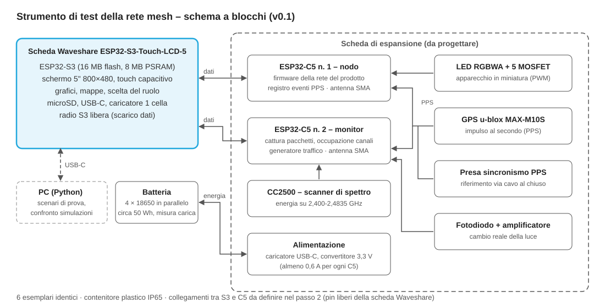

# Strumento di test della rete mesh – specifica v0.1

9 novembre 2026 · passo 1: architettura e componenti principali. Passi successivi: piedinatura e schema elettrico, firmware, software PC.

Un unico apparecchio a batteria, costruito in **6 esemplari identici**, che fa da nodo della rete, da monitor radio e da strumento di rilievo sul campo, con uno **schermo touch da 5 pollici** per vedere grafici e mappe sul posto.

## Ruoli (scelti da schermo)

| Ruolo | Cosa fa |
| --- | --- |
| Nodo sotto prova | Esegue il firmware della rete come un apparecchio vero e registra ogni pacchetto ricevuto, inoltrato e perso |
| Coordinatore | Lancia scene e scenari di prova |
| Monitor | Cattura i pacchetti ESP-NOW, misura l'occupazione dei canali e lo spettro a 2,4 GHz |
| Generatore di traffico | In coppia (un esemplare access point, l'altro client) genera traffico Wi-Fi alla percentuale voluta: traffico Wi-Fi normale, non un disturbatore |
| Rilievo sul campo | Registra per ore portata, potenza ricevuta, occupazione dei canali e sincronia, con riferimento di tempo GPS |

## Architettura

| Blocco | Componente scelto | Funzione |
| --- | --- | --- |
| Interfaccia e gestione | Scheda Waveshare ESP32-S3-Touch-LCD-5 (ESP32-S3-WROOM-1-N16R8, 5", 800×480, IPS, touch capacitivo) | Schermo e grafici, scelta del ruolo, scheda microSD, gestione batteria; la radio dell'S3 resta libera (eventuale scarico dati su telefono o PC) |
| Radio 1: nodo | ESP32-C5-WROOM-1U-N8R8 | Firmware della rete del prodotto; uscite PWM a 5 canali verso il LED RGBWA |
| Radio 2: monitor | ESP32-C5-WROOM-1U-N8R8 | Cattura pacchetti, occupazione dei canali, generatore di traffico |
| Scanner di spettro | TI CC2500 | Lettura dell'energia su tutta la banda 2,400-2,4835 GHz, anche per interferenze non Wi-Fi |
| Riferimento di tempo | u-blox MAX-M10S (GPS, Galileo, GLONASS, BeiDou) | Impulso al secondo (PPS) a entrambi gli ESP32-C5 per misurare la sincronia tra esemplari distanti |
| Sincronismo da banco | Presa di ingresso/uscita PPS via cavo | Riferimento comune al chiuso, dove il GPS non riceve |
| Apparecchio in miniatura | LED RGBWA + 5 MOSFET, PWM dal nodo | Prova di colori e dimmerazione |
| Misura della luce | Fotodiodo con amplificatore (da scegliere) | Istante reale del cambio di luce di un apparecchio vero |
| Alimentazione | 4 celle 18650 in parallelo (1S, circa 50 Wh), caricatore USB-C, misura della carica, convertitore 3,3 V | 24 ore di rilievo con schermo spento |
| Antenne | 2 antenne 2,4 GHz esterne con connettore SMA e cavetti dal modulo | Antenne intercambiabili; si possono portare dentro un corpo in alluminio per provarle |
| Contenitore | Plastico IP65 con finestra per lo schermo | Trasparente alla radio; fissaggio a magnete o a fascetta |

**Perché una scheda display già fatta.** Per 6 esemplari conviene partire dalla scheda Waveshare ESP32-S3-Touch-LCD-5, che contiene già processore, schermo, touch, slot microSD, caricatore per una cella al litio e porta USB-C ([Waveshare](https://www.waveshare.com/esp32-s3-touch-lcd-5.htm?sku=28117)). Si progetta solo una **scheda di espansione** con i due ESP32-C5, GPS, CC2500, LED, fotodiodo e alimentazione. Se lo strumento diventerà un prodotto o servirà uno schermo per pieno sole, si passerà a una scheda propria.

**Come si dividono il lavoro.** I due ESP32-C5 fanno tutto il lavoro in tempo reale: misure radio, registrazione con riferimento PPS e PWM. L'ESP32-S3 riceve da loro dati già elaborati e li mostra. Così la grafica non disturba mai le misure.

## Dati del modulo radio (dal datasheet Espressif)

| Parametro | ESP32-C5-WROOM-1U |
| --- | --- |
| Temperatura di funzionamento | -40 / +85 °C |
| Sensibilità 802.11b 1 Mbps | -99,5 dBm |
| Sensibilità 802.11g 6 Mbps | -94,0 dBm |
| Potenza tipica 802.11b 1 Mbps | 19 dBm |
| Corrente in ricezione | 87 mA (picco) |
| Corrente in trasmissione 802.11b a 19 dBm | 313 mA (picco) |
| Alimentazione | 3,0-3,6 V, alimentatore da almeno 0,6 A |
| Dimensioni | 18,0 × 21,2 × 3,3 mm |

Fonte: [datasheet ESP32-C5-WROOM-1/1U](https://documentation.espressif.com/esp32-c5-wroom-1_wroom-1u_datasheet_en.html). Due ricadute sul progetto principale:
- la temperatura minima del modulo arriva a -40 °C, come i concorrenti premium: il punto aperto 5 del registro delle decisioni è chiuso per il modulo;
- la sensibilità reale è circa 2 dB migliore di quella usata nelle simulazioni: le simulazioni erano prudenti sulla portata.

## Distinta dei componenti principali (per esemplare)

Prezzi letti il 9/11/2026, IVA esclusa, in dollari sui siti dei distributori. Le voci senza prezzo verificato sono segnate "da quotare".

| Componente | Quantità | Prezzo unitario | Fonte | Note |
| --- | --- | --- | --- | --- |
| Waveshare ESP32-S3-Touch-LCD-5 (SKU 28117) | 1 | 36,99 USD (35,79 da 10 pezzi) | [Waveshare](https://www.waveshare.com/esp32-s3-touch-lcd-5.htm?sku=28117) | Luminosità non dichiarata |
| ESP32-C5-WROOM-1U-N8R8 | 2 | da 4,31 USD | [LCSC C51950748](https://www.lcsc.com/product-detail/C51950748.html) | Esaurito su LCSC alla data; disponibile su DigiKey ([DigiKey](https://www.digikey.com.au/en/products/detail/espressif-systems/ESP32-C5-WROOM-1U-N8R8/27566801)) |
| TI CC2500RGP | 1 | da 1,44 USD | [LCSC C1526164](https://www.lcsc.com/product-detail/C1526164.html) | Esaurito su LCSC alla data; servono balun e quarzo |
| u-blox MAX-M10S | 1 | da quotare | [DigiKey](https://www.digikey.ca/en/products/detail/u-blox/MAX-M10S-00B/15712909) | In alternativa un modulo GPS già pronto con antenna e PPS |
| Celle 18650 | 4 | da quotare | — | Celle di marca con protezione |
| Caricatore, misura carica, convertitore 3,3 V, LED RGBWA, MOSFET, fotodiodo, passivi | — | da quotare | — | Si scelgono nel passo 2 |
| Antenne 2,4 GHz SMA e cavetti | 2 | da quotare | — | Verificare il connettore del modulo 1U nel datasheet, sezione 10.2 |
| Contenitore IP65 con finestra | 1 | da quotare | — | Misura minima circa 140 × 100 mm per la scheda display |
| Circuito stampato di espansione | 1 | da quotare | — | Produzione e montaggio JLCPCB |

## Punti aperti per il passo 2

1. **Pin liberi della scheda Waveshare.** Lo schermo a interfaccia parallela usa molti pin dell'S3. La pagina prodotto elenca porte I2C, RS485 e CAN, ma non una seriale libera. Va verificato sullo schema elettrico Waveshare come collegare i due ESP32-C5: seriale, I2C o adattando la porta RS485.
2. **Batteria.** La scheda Waveshare ha un caricatore per una cella al litio da 3,7 V con connettore piccolo (la pagina indica sia MX1.25 sia GH1.25). Va verificato se regge 4 celle in parallelo e una corrente di carica adeguata, oppure se la carica va spostata sulla scheda di espansione.
3. **Leggibilità al sole.** La luminosità dello schermo non è dichiarata. Si prova all'aperto il primo esemplare prima di ordinare gli altri cinque.
4. **Schermo e Wi-Fi.** Lo schermo parallelo usa molta memoria esterna dell'S3. Qui la radio dell'S3 non serve per le misure, quindi il rischio è ridotto.
5. **Fotodiodo.** Scegliere tra un sensore integrato con amplificatore (risposta in millisecondi) e un fotodiodo veloce con amplificatore esterno (microsecondi).
6. **Consumi reali** della scheda display con retroilluminazione accesa e spenta, per confermare l'autonomia di 24 ore.

## Passi successivi

1. **Passo 2**: schema elettrico della scheda di espansione con piedinatura completa e distinta definitiva.
2. **Passo 3**: firmware di test dei due ESP32-C5 (registro eventi, PPS, cattura, scanner) e interfaccia grafica dell'S3.
3. **Passo 4**: software Python sul PC che lancia gli scenari, scarica i registri e confronta misure e simulazioni.
